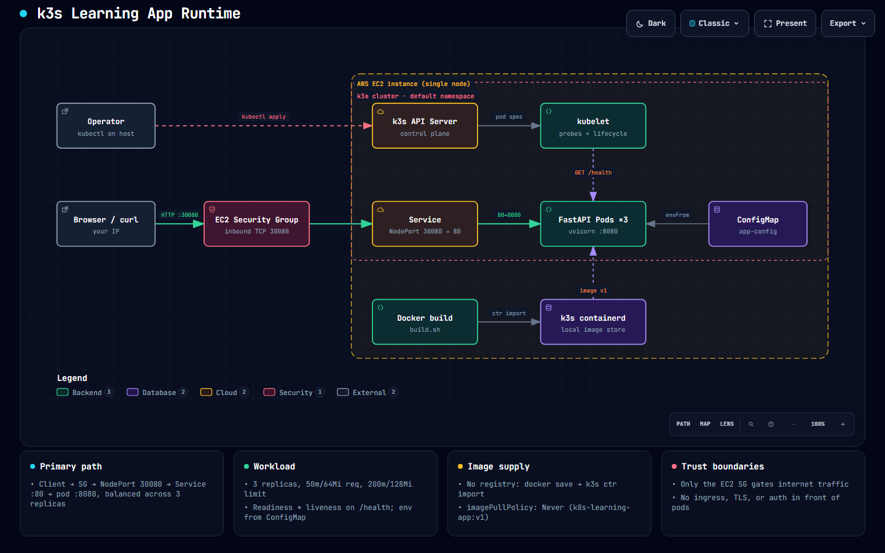

# k3s Kubernetes Learning Project

## What this is

A small FastAPI app deployed to a single-node k3s cluster on an EC2
instance, used to practice real `kubectl` fundamentals: reading plain
YAML manifests, deploying, scaling, rolling updates, and diagnosing common
pod failures (`ImagePullBackOff`, crash-looping probes,
`CreateContainerConfigError`) using `kubectl get`, `describe`, `logs`, and
`get events`.

## What this is NOT

- Not a demonstration of EKS, managed control planes, or multi-node
  cluster operations.
- Not using Helm — every manifest here is plain YAML on purpose, so it can
  be read line by line.
- Not a production setup: no ingress controller, no TLS, no registry, no
  persistent storage, no multi-node scheduling or HA control plane. The
  Service is a NodePort hitting the instance's public IP directly, which
  is fine for learning and wrong for production.

What it does demonstrate: working k8s literacy — deploying an app,
understanding a Deployment/Service/ConfigMap, reading probe and resource
config, and diagnosing/fixing broken pods on a real cluster.

## Architecture

▶️ **[Explore the interactive architecture diagram](https://abdulwaseadev.github.io/k3s-ec2-fastapi/docs/architecture.html)**

[](https://abdulwaseadev.github.io/k3s-ec2-fastapi/docs/architecture.html)

Click the image to open the interactive version: search, focus a component,
trace relationships, switch light/dark, or export.

## Prerequisites

- k3s running on this EC2 instance, `kubectl get nodes` shows the node
  `Ready`.
- Docker installed on the same instance (used to build the image locally).
- The instance's security group allows inbound TCP on port 30080 from
  your IP.

## 1. Build the image and import it into k3s

k3s bundles its own containerd, so there's no need to run or pull from a
registry for a local image.

```bash
chmod +x build.sh
./build.sh
```

This builds `k8s-learning-app:v1` with Docker, saves it as a tar, and
imports it directly into k3s's containerd image store with
`k3s ctr images import`. Verify it landed:

```bash
sudo k3s ctr images list | grep k8s-learning-app
```

## 2. Deploy the working version

```bash
kubectl apply -f k8s/configmap.yaml
kubectl apply -f k8s/deployment.yaml
kubectl apply -f k8s/service.yaml
```

Watch the rollout:

```bash
kubectl get pods -l app=k8s-learning-app -w
```

Once all 3 pods show `1/1 Running`, confirm the Service:

```bash
kubectl get svc k8s-learning-app
```

You should see `TYPE: NodePort` with `80:30080/TCP`.

## 3. Hit it from your browser

Find the instance's public IP (from the EC2 console, or from the instance
itself):

```bash
curl -s http://169.254.169.254/latest/meta-data/public-ipv4
```

Then open in your browser, or curl it:

```bash
curl http://<EC2_PUBLIC_IP>:30080/health
curl http://<EC2_PUBLIC_IP>:30080/
```

`/` returns JSON including a `hostname` field. Refresh a few times (or run
`curl` in a loop) — since the Service load-balances across 3 pod
replicas, you should see the hostname value change between requests.

```bash
for i in {1..10}; do curl -s http://<EC2_PUBLIC_IP>:30080/ | grep hostname; done
```

If this doesn't work, check the EC2 security group allows inbound TCP
30080 from your IP before assuming it's a Kubernetes problem.

## 4. Practice diagnosing broken deployments

Once you've confirmed the working version end-to-end, move on to
[TROUBLESHOOTING.md](TROUBLESHOOTING.md). It walks through three
deliberately broken variants in [k8s/](k8s/):

- `broken-1.yaml` — wrong image tag
- `broken-2.yaml` — liveness probe pointing at the wrong port
- `broken-3.yaml` — ConfigMap key that doesn't exist

Apply one at a time, diagnose it yourself with `kubectl get pods`,
`kubectl describe pod`, `kubectl logs`, and `kubectl get events` before
reading the answer in TROUBLESHOOTING.md.

## 5. Scaling

```bash
kubectl scale deployment k8s-learning-app --replicas=5
kubectl get pods -l app=k8s-learning-app -w
```

Scale back down:

```bash
kubectl scale deployment k8s-learning-app --replicas=3
```

## 6. Rolling update

Bump the app version and rebuild:

```bash
# edit app/main.py, e.g. change the default message
./build.sh   # still tags it v1 by default — edit IMAGE_TAG in build.sh to "v2" first
```

Then trigger a rolling update and watch it roll pod-by-pod with zero
downtime:

```bash
kubectl set image deployment/k8s-learning-app k8s-learning-app=k8s-learning-app:v2
kubectl rollout status deployment/k8s-learning-app
```

Check rollout history, and roll back if needed:

```bash
kubectl rollout history deployment/k8s-learning-app
kubectl rollout undo deployment/k8s-learning-app
```

## 7. Tear down

```bash
kubectl delete -f k8s/service.yaml
kubectl delete -f k8s/deployment.yaml
kubectl delete -f k8s/configmap.yaml
kubectl delete -f k8s/broken-1.yaml --ignore-not-found
kubectl delete -f k8s/broken-2.yaml --ignore-not-found
kubectl delete -f k8s/broken-3.yaml --ignore-not-found
```

**Reminder:** this doesn't stop the EC2 instance itself. Stop or terminate
the instance from the EC2 console when you're done to avoid ongoing
charges.
